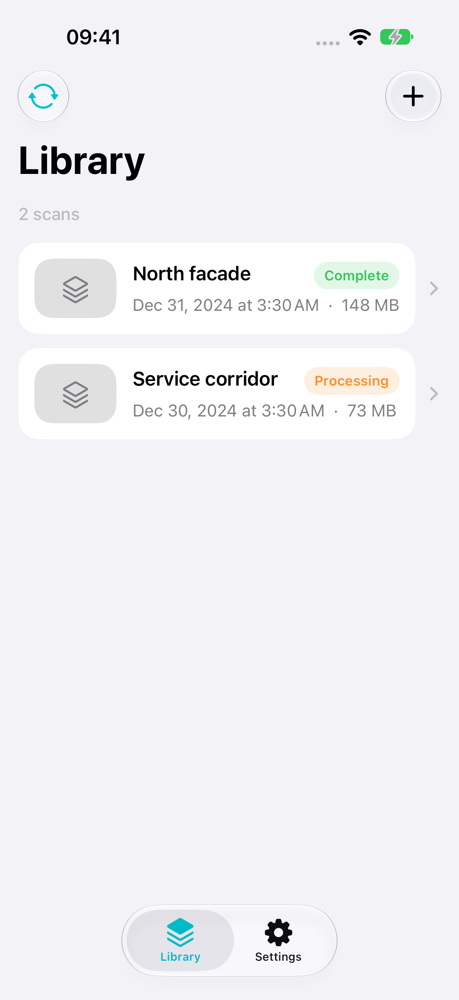
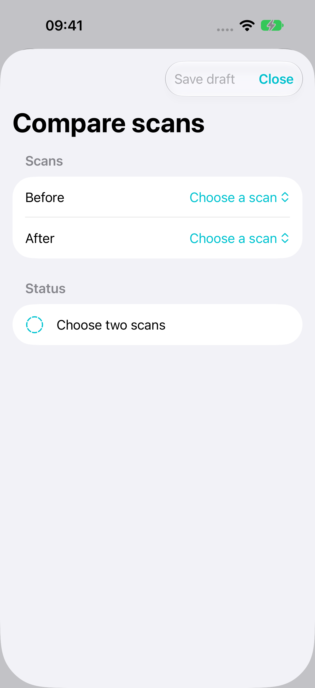
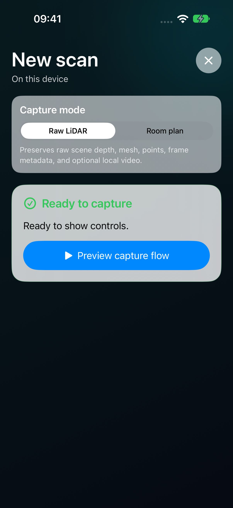

# StrataScan

**A native iOS spatial capture app, built with Swift and SwiftUI.**

Capture a space, keep its evidence on your device, and return to a 3D workspace
for review and export. This portfolio project explores the complete path from
Apple's spatial frameworks to a local, testable application.

<p align="center">
  
  
  
</p>

Screenshots use local sample data in iOS Simulator.
[Explore the screens](docs/screenshots/README.md).

## The experience

- **Capture:** a full-screen workflow for raw ARKit LiDAR or an explicit RoomPlan
  session, with capability checks, tracking guidance, review, and a separate Save.
- **Library:** local scan packages with clear states, dates, and storage sizes.
- **Workspace:** inspect available processed surfaces, raw meshes, point clouds,
  captured images, and saved media; rename, reset the view, or delete a scan.
- **Compare:** choose before/after scans, define a work area, and save a separate
  landmark alignment. Surface previews show observed correspondences.
- **Export:** integrity-gated PLY, GLB, local-coordinate 3D Tiles, and point-cloud
  OPF where the required source evidence exists.

## iOS engineering

| Area | Implementation |
| --- | --- |
| Interface | SwiftUI, Observation, structured navigation, Dynamic Type, VoiceOver labels |
| Spatial frameworks | ARKit, RoomPlan, SceneKit, RealityKit / Quick Look, AVFoundation |
| Concurrency | Swift concurrency, actor isolation, owned tasks, cancellation and recovery |
| Persistence | System SQLite for metadata; immutable managed packages for binary assets |
| Processing | Calibrated RGB-D replay, resumable TSDF submaps, validated surface promotion |
| Testing | Swift Testing, XCTest, injected services, deterministic fixtures, XCUITest |

Views render state and send commands to injected feature services. Composition
owns sessions and dependencies; the local `StrataCore` package owns domain rules,
storage, processing, and platform adapters. No third-party product runtime is
required. [Module overview](docs/ARCHITECTURE.md).
[Feature guide](docs/FEATURES.md).

## Run locally

Use macOS with Xcode, an installed iOS Simulator runtime, Python 3, and
[XcodeGen](https://github.com/yonaskolb/XcodeGen) 2.46 or newer. The app targets
**iOS 18+**. This snapshot was checked with **Xcode 27.0 / iOS 27.0 Simulator**.

```sh
brew install xcodegen
make project
open StrataScan.xcodeproj
```

Select the `StrataScan` scheme and run. The normal app starts with a local empty
library. Real capture requires a compatible physical LiDAR device and camera
permission; the simulator supports interface and software testing.

To explore the same synthetic content used in the screenshots, add these launch
arguments to the scheme's **Run → Arguments** in a Debug build:

```text
-uiTestingLibraryState content -uiTestingScannerState ready
```

These injected demo services keep sample data in memory. They do not create a
real scan or connect to a backend. UI text, permission prompts, dates, and
numbers in this public version are English.

## Build, test, and capture screenshots

```sh
make test-core
make build
make test-ios
make audit
make snapshots
```

The Makefile selects an available iPhone simulator from your active Xcode.
Override it when needed:

```sh
make test-ios DESTINATION='platform=iOS Simulator,name=iPhone 18 Pro,OS=27.0'
```

`make snapshots` drives the real interface through XCUITest and exports six PNGs
and a checksum manifest. Full logs and result bundles stay in the ignored `.ci/`
folder. Signing overrides belong in the ignored
`Configuration/Signing.xcconfig`; no account or network service is needed for
local capture and review.

## Project map

| Path | Purpose |
| --- | --- |
| `App/` | SwiftUI screens and application composition |
| `Packages/StrataCore/` | Domain, storage, spatial processing, and platform adapters |
| `Tests/` | App tests, UI flows, and screenshot capture |
| `Configuration/` | Non-secret build environments |
| `docs/` | Feature guide, module overview, and screenshots |
| `tools/` | Repository audit, simulator selection, and screenshot tooling |
| `mock-server/` | Optional local API contract fixture; separate from capture |

## Device support

Raw depth and mesh capture require a LiDAR-capable iPhone or iPad. RoomPlan is
available on devices that report support. The app checks capabilities and
permissions before starting a session. Saved scans remain available offline.
