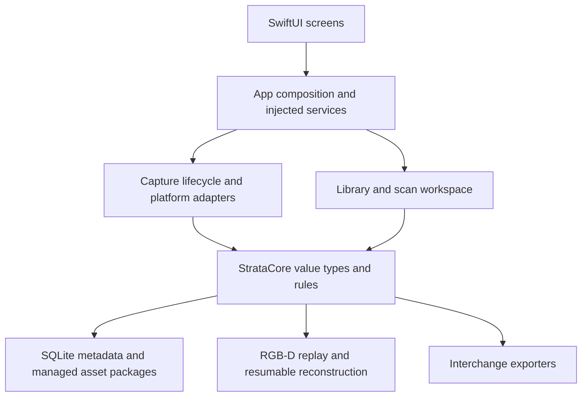

# Modules and Architecture

The product runtime uses Swift and Apple system frameworks. One local Swift
package keeps the domain and infrastructure testable independently of the app.

| Module | Responsibility | Location |
| --- | --- | --- |
| App shell | Dependency composition, tab navigation, full-screen capture routes | `App/Sources/StrataScanApp.swift`, `AppPresentation.swift` |
| Presentation | Library, scanner workflow, saved workspace, comparison, settings, English formatting | `App/Sources/` |
| Scanner | Capability checks, lifecycle, essential capture events, calibrated RGB-D evidence | `Packages/StrataCore/Sources/StrataCore/Scanner/` |
| Platform | ARKit, RoomPlan, camera, resource, and system integrations | `Packages/StrataCore/Sources/StrataCore/Platform/` |
| Storage | SQLite migrations, metadata repositories, package integrity, external asset files | `Packages/StrataCore/Sources/StrataCore/Storage/` |
| Spatial processing | Point clouds, calibrated projection, TSDF submaps, extraction, surface validation | `Packages/StrataCore/Sources/StrataCore/Spatial/` |
| Alignment and measurement | Explicit transforms, coordinate-aware layers, landmarks, and comparison inputs | `Alignment/`, `GIS/`, `Mining/` under the core sources |
| App services and sync | Credential abstractions, alerts, typed API contracts, durable queue foundations | `AppServices/`, `Sync/` under the core sources |
| Tests | Deterministic domain tests, app integration tests, UI navigation, screenshots | `Packages/StrataCore/Tests/`, `Tests/` |

## Ownership and data flow

SwiftUI views render state and send commands. Feature services own asynchronous
work; app composition supplies sessions, repositories, and adapters. Capture
adapters copy framework data into core values rather than letting views manage
AR sessions or perform storage operations.

SQLite holds metadata and references. Large assets live in managed scan
packages. Saving finalizes a package; reconstruction writes derived output
separately. Alignment is a persisted transform, leaving original geometry
immutable. Coordinates use meters and explicit column-major transforms.

Long-running work has an owner, cancellation, and recovery boundaries. Selected
RGB-D records can be replayed through resumable TSDF submaps. A surface is
promoted only after structural validation, and viewers and exporters read the
corresponding validated asset.

## Verification and demos

Swift Testing and XCTest exercise domain rules, persistence, cancellation,
package integrity, geometry contracts, and app composition. XCUITest drives the
visible user flows and captures screenshot attachments. Injected local demo
services provide sample content without hardware or network access.

Real camera, depth, LiDAR, and RoomPlan operation requires compatible physical
hardware. Simulator tests cover software and interface behavior.
