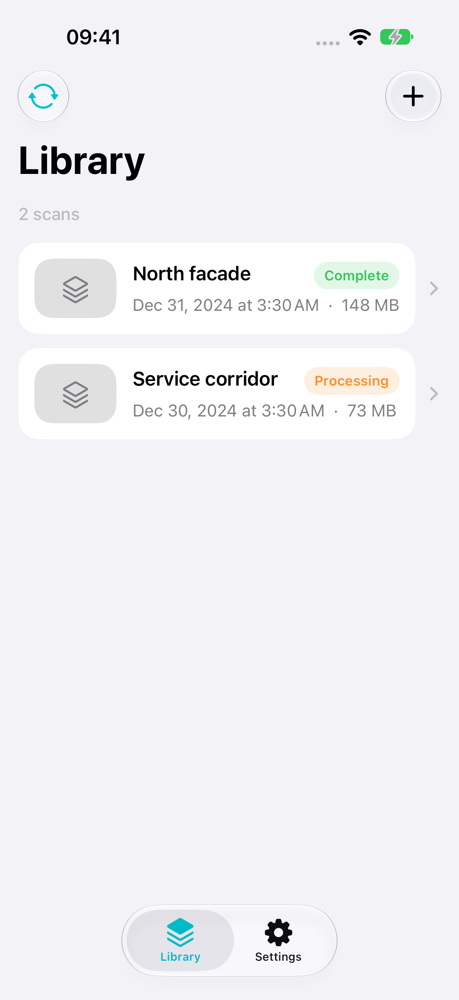
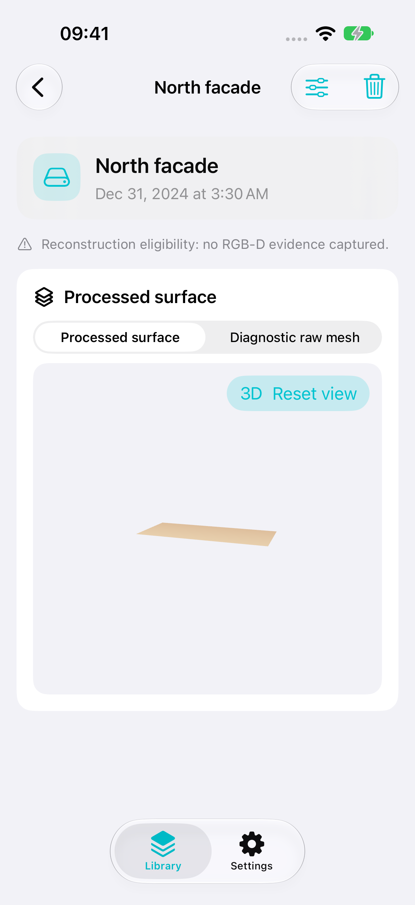
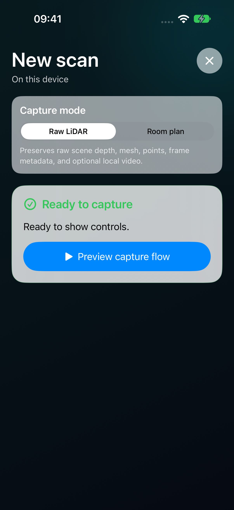
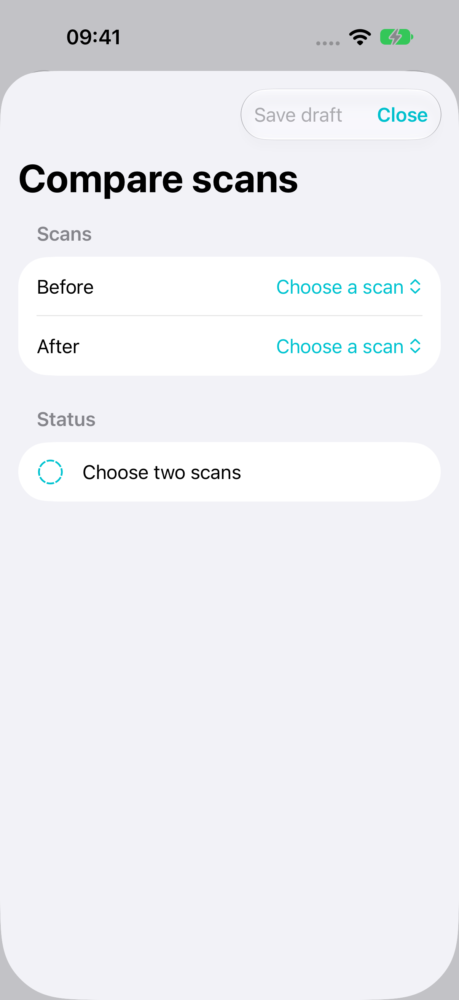
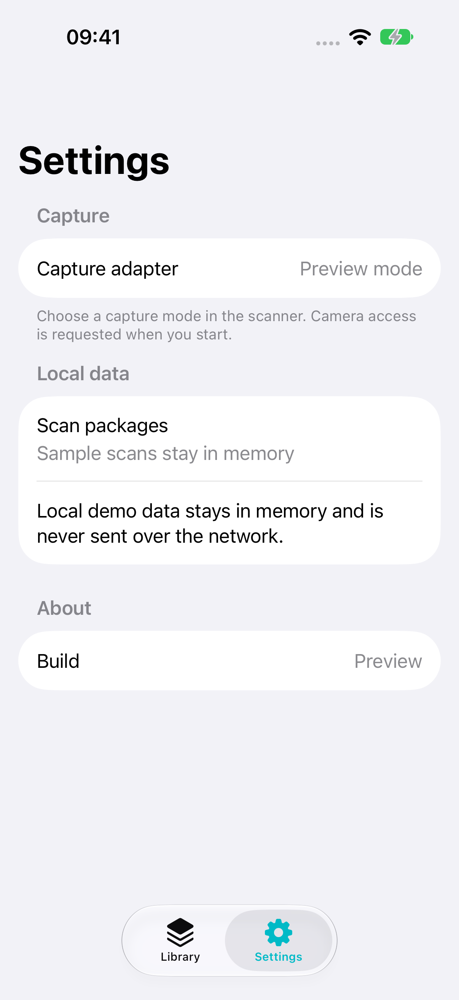
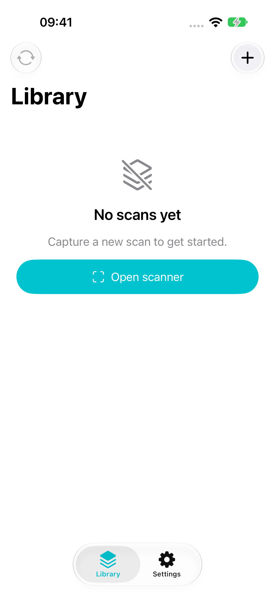

# Interface screenshots

English screenshots from the running app in iOS Simulator. All sample scans,
metadata, and geometry come from the existing deterministic UI-test services.
No private room, camera image, or real scan package is included.

| Library | Workspace | Scanner |
| --- | --- | --- |
|  |  |  |

| Comparison setup | Settings | Empty library |
| --- | --- | --- |
|  |  |  |

Regenerate from the repository root with `make snapshots`. The capture test is
`PortfolioSnapshotTests.testEnglishPortfolioSnapshots`; the script exports its
native screenshot attachments without compositing or repainting the interface.
[Provenance and image checksums](provenance.json) record the toolchain and content
boundary. The images show interface states with sample data.
